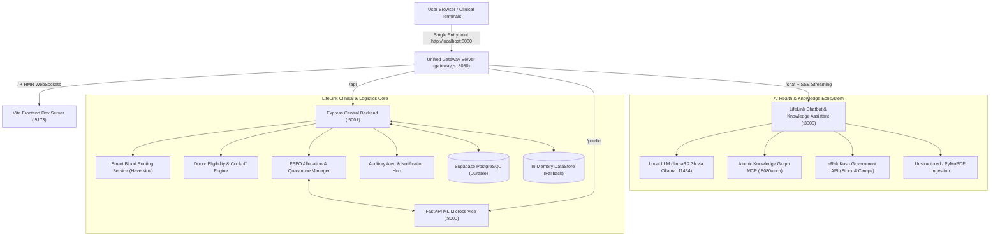

# 🩸 LifeLink — Intelligent Blood Donation, Inventory Management & Emergency Logistics Platform

[](https://nodejs.org/)
[](https://reactjs.org/)
[](https://www.typescriptlang.org/)
[](https://vitejs.dev/)
[](https://tailwindcss.com/)
[](https://fastapi.tiangolo.com/)
[](https://supabase.com/)
[](https://www.docker.com/)

> **LifeLink** is a mission-critical healthcare platform uniting blood banks, hospitals, and voluntary donors into an automated, real-time clinical logistics network. It eliminates manual coordination during acute hemorrhages through automated Haversine emergency blood routing, 5-marker serology safety gates, FEFO inventory allocation, cold-chain thermal handoffs, and AI-powered demand forecasting.

---

## 📑 Table of Contents

- [Core Capabilities & Clinical Innovations](#-core-capabilities--clinical-innovations)
- [System Architecture & Unified Gateway](#-system-architecture--unified-gateway)
- [Portal Ecosystem & User Workflows](#-portal-ecosystem--user-workflows)
  - [1. Donor Engagement & Digital Pass Portal](#1-donor-engagement--digital-pass-portal)
  - [2. Blood Bank Operations & Laboratory Hub](#2-blood-bank-operations--laboratory-hub)
  - [3. Hospital Requisition & Transfusion Portal](#3-hospital-requisition--transfusion-portal)
  - [4. Smart Emergency Routing & Web Audio Alert Engine](#4-smart-emergency-routing--web-audio-alert-engine)
  - [5. AI / ML Demand & Wastage Microservice](#5-ai--ml-demand--wastage-microservice)
  - [6. LifeLink Health & Wellness AI Chatbot Companion](#6-lifelink-health--wellness-ai-chatbot-companion)
- [Technology Stack](#-technology-stack)
- [Project Directory Structure](#-project-directory-structure)
- [Quick Start & Local Setup](#-quick-start--local-setup)
  - [Prerequisites](#prerequisites)
  - [Option A: Unified Multi-Service Dev Runner (Recommended)](#option-a-unified-multi-service-dev-runner-recommended)
  - [Option B: Containerized Deployment (Docker Compose)](#option-b-containerized-deployment-docker-compose)
  - [Option C: Dedicated ML Microservice Setup](#option-c-dedicated-ml-microservice-setup)
- [Configuration & Environment Variables](#-configuration--environment-variables)
- [Pre-Configured Test Fixtures & Accounts](#-pre-configured-test-fixtures--accounts)
- [Automated Testing & Quality Assurance](#-automated-testing--quality-assurance)
- [API Reference Overview](#-api-reference-overview)
- [Health Probes & Telemetry](#-health-probes--telemetry)
- [Regulatory & Clinical Safety Disclaimer](#-regulatory--clinical-safety-disclaimer)

---

## 🌟 Core Capabilities & Clinical Innovations

- **Unified Single-Port Entrypoint**: A lightweight API Gateway (`gateway.js` on port `8080`) blends the React/Vite frontend, Express backend, FastAPI ML service, and AI Chatbot with WebSocket HMR and zero-buffer SSE streaming.
- **Smart Emergency Auto-Routing**: Dynamically computes Haversine geodesic distances between trauma centers and licensed blood banks, expanding search radiuses (25 km &rarr; 50 km &rarr; 75 km &rarr; 100 km) and broadcasting non-blocking multi-bank offers linked to a single canonical request (`REQ-XXXX`).
- **Dual-Tone 5-Second Auditory Alarm**: Synthesizes urgency alerts via Web Audio API (interlocking 880 Hz / 587.33 Hz carrier waves) with local mute control, dismiss-for-session flags, and browser-refresh anti-replay protections.
- **5-Marker Serology Safety Gate**: Pre-release clearance mandates individual verification for **HIV 1/2, HBsAg, HCV, Syphilis (VDRL/RPR)**, and **Malaria**, strictly preventing unverified quarantine stock from entering active allocation pools.
- **Strict Cool-Off & Deferral Tracking**: Enforces authoritative recovery intervals (56 days for Whole Blood, 90 days for RBC) with countdown timers and duplicate collection rejection.
- **End-to-End Cold Chain Integrity**: Logs thermal packaging configurations, tamper-evident security seals, and strict transit temperature parameters (2.0°C – 6.0°C) with hospital delivery receipt confirmation.
- **AI Demand & Wastage Forecasting**: FastAPI microservice running predictive models to project component demand, evaluate shortage risk, and trigger early warning alerts for nearing-expiry units.
- **Dual-Tier Resilient Persistence**: Supabase PostgreSQL durable cloud storage paired with an in-memory `DataStore` fail-safe with bi-directional mutation synchronization and offline degraded execution.

---

## 🏛 System Architecture & Unified Gateway



---

## 🚀 Portal Ecosystem & User Workflows

### 1. Donor Engagement & Digital Pass Portal
- **Identity & Blood Group Verification**: Newly registered donors remain gated until blood bank staff review lab documentation, unlocking an authentic green verification badge and digital donor pass with QR verification.
- **Clinical Cool-Off Protection**: Automatically calculates remaining days before eligible donation (e.g. 56 days post whole-blood donation) and prevents duplicate registration attempts.
- **Nearby Hospital & Camp Directory**: Integrated OpenStreetMap Nominatim geocoding and Leaflet map views to locate nearby health centers and mobile donation camps based on verified GPS coordinates.
- **Camp Organization**: Enables civic organizations to schedule community blood drives, directly routed to blood bank administrators for scheduling and venue approval.

### 2. Blood Bank Operations & Laboratory Hub
- **Phlebotomy & Collections Registry**: In-house phlebotomy logging with component fractionation into RBC and Plasma.
- **5-Marker Infectious Disease Screening Gate**: Units remain in Laboratory Quarantine with pre-release validation. Premature authorization attempts are rejected by both frontend validation and backend HTTP 422 constraints.
- **Hospital Requests Hub & FEFO Allocation Drawer**: Evaluates incoming clinical requisitions against unreserved, released stock sorted strictly by First-Expiry-First-Out. Displays amber diagnostic banners detailing quarantined units awaiting clearance.
- **Cold Chain Packaging & Dispatch**: Prepares thermal shippers with phase-change gel packs, logs security seals (`SEAL-XXXX`), and assigns couriers for tracked emergency handoffs.

### 3. Hospital Requisition & Transfusion Portal
- **Clinical Requisition Builder**: Create emergency or routine blood requests (`REQ-XXXX`) with targeted blood groups, required units, clinical indications, and urgency tags.
- **Smart Emergency Auto-Routing Option**: Initiates automated discovery of nearby facilities with matching stock.
- **Cold-Chain Transit Tracking & Safe Receipt**: Validates physical container seals, records courier arrival temperature (2.0°C – 6.0°C), and issues final fulfillment clearance.
- **Patient Cross-Match Sample Registry**: Tracks pre-transfusion patient blood samples and crossmatch clearances.

### 4. Smart Emergency Routing & Web Audio Alert Engine
- **Non-Blocking Multi-Bank Offers**: The system generates independent offer tickets (`OFF-REQ-XXXX-BB-XXXX`) for compatible blood centers without spawning duplicate hospital requisitions.
- **Iterative Radius Expansion**: Searches a baseline 25 km radius. If stock is insufficient, automatically expands to 50 km, 75 km, and up to 100 km.
- **Dual-Tone Synthesizer**: Uses Web Audio API to create non-looping, urgent auditory cues on clinical terminals, complete with mute switches, dismiss flags, and anti-replay guards across browser refreshes.

### 5. AI / ML Demand & Wastage Microservice
- **Demand Forecasting**: Predicts regional 7-day and 30-day component needs to assist blood centers with phlebotomy scheduling.
- **Shortage Mitigation**: Evaluates live inventories against historical consumption patterns to identify high-risk blood groups.
- **Wastage Risk Minimization**: Flags units nearing expiration (e.g. platelets with 5-day shelf-life) for expedited allocation or cross-facility transfer.

### 6. LifeLink Health & Wellness AI Chatbot Companion (`/chat`)
- **Conversational Health Assistant**: An empathetic, educational health companion running locally via Ollama (`llama3.2:3b`) with smooth Server-Sent Events (SSE) token streaming.
- **Atomic Knowledge Graph (MCP) & PDF Ingestion**: Users can attach medical lab reports, discharge summaries, or clinical guidelines; the companion processes PDFs via Unstructured / PyMuPDF and indexes atoms into Atomic Knowledge Graph.
- **Real-Time eRaktKosh Blood Availability**: Live stock queries for 35 Maharashtra districts across PRBC and Whole Blood components (including rare Bombay Oh+ / Oh- blood groups).
- **Nearby Blood Donation Camps**: Instant district-wise camp lookup via official eRaktKosh government API proxy.

---

## 🛠 Technology Stack

| Domain | Technologies |
| :--- | :--- |
| **Unified API Gateway** | Node.js, Express, `http-proxy-middleware` 3.0, `concurrently` 8.2 |
| **Frontend Framework** | React 18.3, TypeScript 5.2, Vite 5.2 |
| **Styling & Icons** | TailwindCSS 3.4, Lucide React, PostCSS, Autoprefixer |
| **Mapping & Visuals** | Leaflet 1.9, React-Leaflet, Recharts 2.12 |
| **Backend API Server** | Node.js, Express 4.19, TypeScript 5.4, ts-node-dev |
| **Security & Middleware** | Helmet 8.3, CORS, express-rate-limit 8.7, JWT (jsonwebtoken), bcryptjs |
| **AI Chatbot & Knowledge** | Express 5, Ollama (`llama3.2:3b`), Atomic MCP, Unstructured / PyMuPDF |
| **Persistence & Cloud DB** | Supabase JS 2.117 (PostgreSQL), Resilient In-Memory `DataStore` |
| **AI / Machine Learning** | Python 3.9+, FastAPI, Uvicorn, Scikit-Learn, NumPy, Pandas |
| **Containerization** | Docker, Docker Compose, Multi-stage builds, Nginx |

---

## 📂 Project Directory Structure

```text
LifeLink-Miniproject/
├── gateway.js                  # Unified API Gateway (http://localhost:8080)
├── backend/                    # Express API Server (port 5001)
│   ├── src/
│   │   ├── config/             # Environment validation & configurations
│   │   ├── controllers/        # Express request handlers (auth, donor, bloodBank, hospital, etc.)
│   │   ├── middleware/         # Security headers, rate limiting, request logging, error handling
│   │   ├── models/             # Schema definitions, Supabase sync engine, and in-memory DataStore
│   │   ├── routes/             # REST route definitions (/api/*)
│   │   ├── services/           # Smart blood routing, notification service, donor eligibility logic
│   │   ├── utils/              # Haversine formula, geo-helpers, audit utilities
│   │   └── server.ts           # Express HTTP server setup & graceful shutdown protocol
│   ├── tests/                  # Backend integration & routing test suites
│   └── package.json            # Backend scripts and dependencies
├── frontend/                   # React 18 + Vite SPA (port 5173)
│   ├── src/
│   │   ├── components/         # Reusable UI components (Navbar, Sidebar, EmergencyAlertBanner)
│   │   ├── contexts/           # React context providers (AuthContext, NotificationContext)
│   │   ├── pages/              # Portal views (donor, hospital, bloodbank, public)
│   │   ├── services/           # Axios/Fetch API client wrappers
│   │   ├── tests/              # End-to-end integration test suites (node:test)
│   │   └── App.tsx             # Route definitions & Role-Protected route wrappers
│   └── vite.config.ts          # Vite build configurations
├── chatboot/                   # LifeLink AI Health & Wellness Chatbot (port 3000)
│   ├── public/                 # Chatbot SPA (index.html, app.js, style.css)
│   ├── server.js               # Express 5 server with SSE streaming & eRaktKosh proxy
│   ├── mcpClient.js            # Atomic Knowledge Graph MCP client
│   ├── ollamaClient.js         # Ollama streaming LLM client (llama3.2:3b)
│   └── pdf_to_markdown.py      # Unstructured / PyMuPDF document parser
├── ml-service/                 # AI Demand & Wastage Microservice (port 8000)
│   ├── models/                 # ML predictor logic & statistical heuristics
│   ├── main.py                 # FastAPI microservice entrypoint (:8000)
│   └── requirements.txt        # Python package dependencies
├── DEPLOYMENT_RUNBOOK.md       # Production runbook, zero-downtime rotation & DR procedures
├── LIFELINK_END_TO_END_TESTING_GUIDE.md  # Step-by-step cross-portal testing guide
├── docker-compose.yml          # Production multi-service container orchestration
├── package.json                # Root orchestration workspace scripts & concurrently runner
└── .env.example                # Sample environment configuration template
```

---

## ⚡ Quick Start & Local Setup

### Prerequisites
- **Node.js**: v18.x or v20.x LTS installed
- **npm**: v9.x or later
- **Python**: v3.9+ (for ML microservice & Chatbot PDF ingestion)
- **Ollama**: (optional, for running local `llama3.2:3b` in the chatbot)
- **Docker & Docker Compose** (optional, for containerized run)

---

### Option A: Unified Multi-Service Dev Runner (Recommended)

1. **Clone the repository:**
   ```bash
   git clone https://github.com/Dushyant42487/LifeLink-Miniproject.git
   cd LifeLink-Miniproject
   ```

2. **Install all dependencies across root and subprojects:**
   ```bash
   npm run install:all
   ```

3. **Configure Environment Variables:**
   ```bash
   cp .env.example .env
   ```
   *(Ensure `CORS_ALLOWED_ORIGINS=http://localhost:8090,http://localhost:8080,http://localhost:5173,http://localhost:3000` is present).*

4. **Start All Services Concurrently (One Command):**
   ```bash
   npm run dev
   ```
   This single command boots the entire ecosystem:
   - **Unified Gateway**: `http://localhost:8090` *(default changed to 8090 to avoid collision with Oracle XDB on 8080)*
   - **Main Portal (Vite)**: `http://localhost:5173` (proxied to `http://localhost:8090/`)
   - **Backend API**: `http://localhost:5001` (proxied to `http://localhost:8090/api`)
   - **FastAPI ML Service**: `http://localhost:8000` (proxied to `http://localhost:8090/predict`)
   - **Chatbot Companion**: `http://localhost:3000` (proxied to `http://localhost:8090/chat/`)

5. **Access the Application in Your Browser:**
   - **Main LifeLink Platform**: [http://localhost:8090/](http://localhost:8090/) (or directly at [http://localhost:5173/](http://localhost:5173/))
   - **AI Health Assistant Chatbot**:
     - **In-App Floating Widget**: Click the floating **"AI Health Assistant"** button in the bottom-right corner of any page.
     - **In-App Navbar Button**: Click the **"AI Assistant"** button in the top navigation bar.
     - **Direct URL (via Gateway)**: [http://localhost:8090/chat/](http://localhost:8090/chat/)
     - **Direct URL (Standalone)**: [http://localhost:3000/](http://localhost:3000/)
   - **Backend Health Telemetry**: [http://localhost:8090/api/health](http://localhost:8090/api/health)
   - **ML Demand Predictor**: [http://localhost:8090/predict/demand](http://localhost:8090/predict/demand)

6. **Seed Test Fixtures (Optional):**
   ```bash
   curl -X POST http://localhost:8090/api/test/seed-fixtures
   ```

---

### Option B: Containerized Deployment (Docker Compose)

Deploy the entire production stack (backend API + frontend Nginx server) with a single command:

```bash
# Build and run containers in detached mode
docker-compose up -d --build

# Inspect running services
docker-compose ps
```

- **Frontend Application**: [http://localhost:3000](http://localhost:3000)
- **Backend Health Check**: [http://localhost:5001/api/health](http://localhost:5001/api/health)

---

### Option C: ML Microservice Setup

To run the AI Demand & Wastage prediction engine:

```bash
cd ml-service
python -m venv venv

# On Linux/macOS:
source venv/bin/activate
# On Windows:
venv\Scripts\activate

pip install -r requirements.txt
python main.py
```
*The FastAPI service runs on [http://localhost:8000](http://localhost:8000). Interactive Swagger documentation is available at [http://localhost:8000/docs](http://localhost:8000/docs).*

---

## ⚙️ Configuration & Environment Variables

Copy `.env.example` to `.env` and adjust the configuration as required:

| Variable | Default (Dev) | Description |
| :--- | :--- | :--- |
| `GATEWAY_PORT` | `8080` | Unified API Gateway port routing to all services. |
| `NODE_ENV` | `development` | Environment mode (`development`, `test`, `production`). |
| `PORT` | `5001` | Express API server network port. |
| `JWT_SECRET` | *(Random 32+ char)* | Cryptographic key for signing user authentication tokens. |
| `CORS_ALLOWED_ORIGINS` | `http://localhost:8080,http://localhost:5173,http://localhost:3000` | Whitelisted cross-origin domains. |
| `SUPABASE_URL` | *(Optional)* | Managed Supabase PostgreSQL project URL. |
| `SUPABASE_SECRET_KEY` | *(Optional)* | Supabase Service Role API key. |
| `SUPABASE_ANON_KEY` | *(Optional)* | Supabase Anonymous public API key. |
| `VITE_API_BASE_URL` | `/api` | Base URL used by the frontend to communicate with the backend. |
| `LOG_LEVEL` | `info` | Granularity for operational logs (`error`, `warn`, `info`, `debug`). |

> [!NOTE]
> **Atomic MCP Port Notice**: The Chatbot's Atomic MCP Client connects by default to `http://localhost:8080/mcp`. If your Atomic Knowledge Graph daemon is actively running on port `8080`, adjust `GATEWAY_PORT=8090` in `.env` to prevent an `EADDRINUSE` port collision.

> **Note**: If `SUPABASE_URL` is omitted, LifeLink automatically runs in resilient in-memory fallback mode, preserving records in `datastore.json` for rapid local iteration.

---

## 🔑 Pre-Configured Test Fixtures & Accounts

Reset or populate the standard demonstration scenario at any time with:
```bash
curl -X POST http://localhost:5001/api/test/seed-fixtures
```

| Portal Role | Email | Password | Organization / Name |
| :--- | :--- | :--- | :--- |
| **Blood Bank Staff** | `admin@redcrossblood.org` | `password123` | Metropolitan Red Cross Blood Center |
| **Hospital Staff** | `stjudes@metrohealth.org` | `password123` | St. Jude Children's Memorial Hospital |
| **Verified Active Donor** | `sarah.j@example.com` | `password123` | Sarah Jenkins (A+ Donor, Fully Verified) |
| **Unverified New Donor** | *Register in UI* | *Your choice* | Created via `/register` (Gated verification) |

---

## 🧪 Automated Testing & Quality Assurance

LifeLink includes an extensive suite of automated tests verifying clinical invariants, geographic routing algorithms, cold chain handoffs, and serology gates.

Run the test suites from the `frontend/` directory using Node's native test runner:

```bash
# Run all automated integration suites
npm --prefix frontend test
```

### Targeted Test Suites

```bash
# 1. 5-Marker Lab Screening Queue & REQ-6809 Allocation Gate
node ./frontend/src/tests/labScreeningAndAllocation.test.mjs

# 2. Smart Blood Emergency Routing & Geodesic Calculation
node ./backend/tests/smartBloodRouting.test.mjs

# 3. Emergency Audio Alarm Routing & Tone Controls
node ./backend/tests/emergencyAlarmRoutingAndToneControls.test.mjs

# 4. Donor Eligibility, Cool-Off Countdown & Deferral Verification
node ./frontend/src/tests/donorEligibilityVerification.test.mjs

# 5. Full-Stack End-to-End Workflow Audit & Repairs
node ./frontend/src/tests/workflowAuditAndRepairs.test.mjs

# 6. Cold Chain Custody & Thermal Receipt Verification
node ./frontend/src/tests/coldStorageSuite.test.mjs

# 7. Clean End-to-End Cross-Portal Lifecycle
node ./frontend/src/tests/cleanEndToEndWorkflow.test.mjs
```

---

## 📡 API Reference Overview

The backend exposes a clean RESTful API:

### Authentication & Profiles
- `POST /api/auth/register` — Register a donor, hospital, or blood bank account.
- `POST /api/auth/login` — Authenticate and receive a signed JWT token.
- `GET /api/auth/me` — Retrieve active session profile and verified role permissions.

### Donor Operations (`/api/donors`)
- `GET /api/donors/eligibility` — Retrieve donation eligibility status, deferral reasons, and cool-off countdowns.
- `GET /api/donors/nearby-hospitals` — Discover nearby facilities with Haversine distance calculations.
- `POST /api/donors/verify-blood-group` — Upload blood group certification or lab reports for staff verification.
- `POST /api/donors/camps/request` — Submit a community blood donation drive proposal.

### Blood Bank Management (`/api/blood-bank`)
- `GET /api/blood-bank/inventory` — Inspect current inventory grouped by component and expiry.
- `POST /api/blood-bank/collections` — Record phlebotomy collection (with duplicate entry guard).
- `POST /api/blood-bank/fractionate` — Fractionate whole blood into RBC and plasma components.
- `POST /api/blood-bank/test-unit` — Record 5-marker serology screening results (HIV, HBV, HCV, Syphilis, Malaria).
- `POST /api/blood-bank/release-unit` — Release fully cleared quarantine units to available stock.
- `POST /api/blood-bank/allocate` — Allocate eligible FEFO units to an open requisition.
- `POST /api/blood-bank/dispatch` — Authorize thermal packaging shipper, security seal, and courier dispatch.

### Hospital Requisitions (`/api/hospitals`)
- `POST /api/hospitals/requests` — Create clinical blood requisition (`REQ-XXXX`).
- `POST /api/hospitals/emergency-route` — Trigger Smart Auto-Routing with iterative radius expansion.
- `GET /api/hospitals/requests` — Monitor requisition state transitions and incoming dispatches.
- `POST /api/hospitals/confirm-receipt` — Confirm delivery, log recipient temperature, and inspect seal integrity.

### Health Probes & Telemetry (`/api/health`)
- `GET /api/health` — Full operational health telemetry (storage mode, memory RSS/heap, entity counts).
- `GET /api/health/live` — Liveness probe (HTTP 200 `{ status: "alive" }`).
- `GET /api/health/ready` — Readiness probe (HTTP 200 `{ status: "ready" }`).

### AI / ML Endpoints (`:8000`)
- `POST /predict/demand` — Component demand forecast over 7–30 day periods.
- `POST /predict/shortage` — Shortage vulnerability analysis based on current stock vs. demand.
- `POST /predict/wastage` — Expiry risk score for units nearing shelf-life limits.

---

## 🩺 Regulatory & Clinical Safety Disclaimer

> [!IMPORTANT]
> **Clinical Notice**: LifeLink provides algorithmic coordination, inventory optimization, and decision-support assistance. All blood component clearances, cross-matching assessments, and transfusion decisions must remain under the direct authorization of certified laboratory technicians, pathologists, and medical practitioners in compliance with applicable regional healthcare standards (e.g., AABB, WHO, FDA, or local national blood transfusion guidelines).

---

## 📄 License & Documentation

- **Testing Guide**: See [LIFELINK_END_TO_END_TESTING_GUIDE.md](file:///c:/Users/harsh/OneDrive/Desktop/LifeLink-Miniproject/LIFELINK_END_TO_END_TESTING_GUIDE.md) for detailed verification steps.
- **Production Runbook**: See [DEPLOYMENT_RUNBOOK.md](file:///c:/Users/harsh/OneDrive/Desktop/LifeLink-Miniproject/DEPLOYMENT_RUNBOOK.md) for secret rotation, disaster recovery, and container orchestration runbooks.
- **Smart Blood Routing Architecture**: See [LIFELINK_SMART_BLOOD_ROUTING.md](file:///c:/Users/harsh/OneDrive/Desktop/LifeLink-Miniproject/LIFELINK_SMART_BLOOD_ROUTING.md) for mathematical formulations of the Haversine dispatch pipeline.
- **License**: MIT License. Developed for healthcare innovation and life-saving blood logistics.
